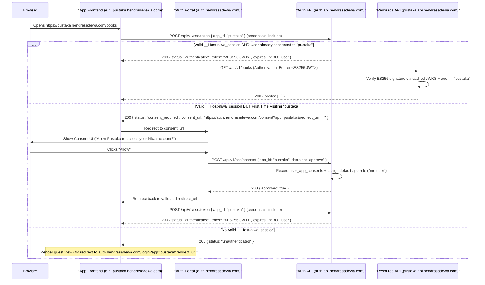
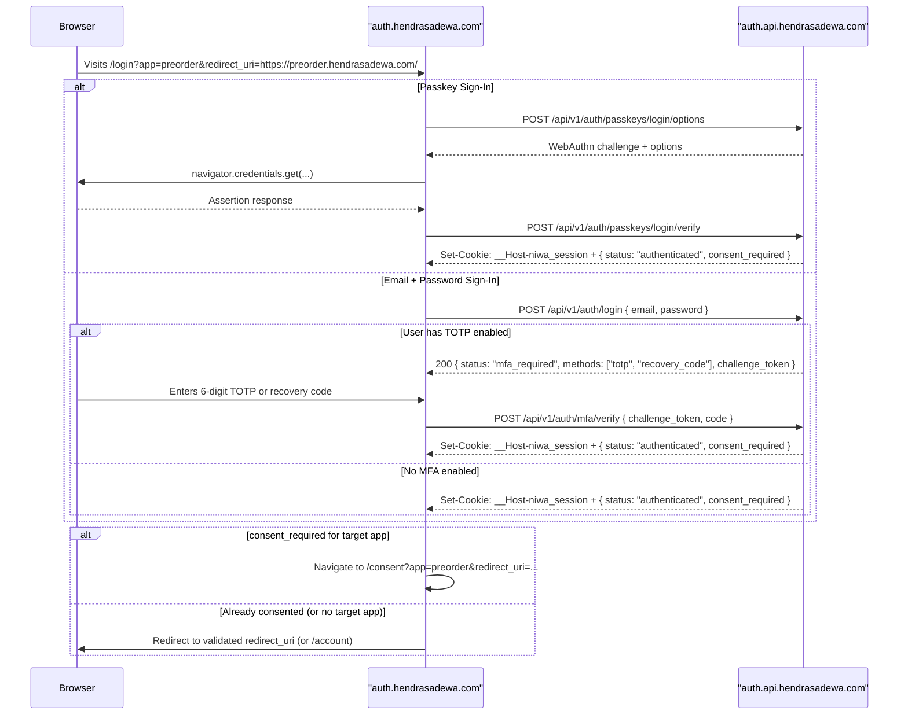

# Niwa Identity Provider (IdP) & First-Party SSO Architecture

> **Status:** Target Architecture Specification (Approved Design Decisions)
> **Scope:** `apps/auth-api`, `apps/auth-web` (new), `apps/open-po-api`, `apps/open-po-webapp`, `apps/pustaka-api`, `apps/pustaka-web`, `apps/web`, `apps/labs`, and future Niwa products.
> **Implementation Convention:** All backend services follow [`niwa-api-architecture`](../../.agents/skills/niwa-api-architecture/SKILL.md) (Hono v4 + Drizzle ORM + Cloudflare D1 + Zod + Factory DI + Error Catalog).

---

## 1. Architectural Decisions Summary

This specification captures the finalized design decisions for turning `@niwa/auth-api` into a centralized **first-party Identity Provider (IdP)** with automatic Single Sign-On (SSO), Global Single Logout (SLO), explicit first-time app consent, asymmetric `ES256` + JWKS verification, and a dedicated Account & Security portal.

| Decision Area | Finalized Choice | Architectural Implication |
| :--- | :--- | :--- |
| **Root Domain** | Single root domain: `*.hendrasadewa.com` | All Niwa web apps and APIs are **same-site** (`hendrasadewa.com`), enabling `SameSite=Lax` cookie-backed silent SSO without third-party cookie issues. |
| **IdP Scope** | First-party Niwa apps only | Lean, purpose-built first-party SSO protocol (no full third-party OAuth2 dynamic registration needed, while keeping clean OIDC-like conventions). |
| **Cross-App Login** | **Automatic silent login** | Returning users signed into one app are silently authenticated on other consented apps with zero extra clicks. |
| **Cross-App Logout** | **Global Single Logout (SLO)** | Logging out from any app revokes the central IdP session and clears the IdP cookie across all Niwa apps. |
| **Hosted Portal UI** | Dedicated frontend: `apps/auth-web` (`auth.hendrasadewa.com`) | Centralizes Login, Register, Consent, Email Verification, Password Reset, User Account/Security Dashboard (Passkeys, TOTP, Sessions), and Admin ACL Dashboard. |
| **Token Signing** | **Asymmetric `ES256` + `/.well-known/jwks.json`** | Downstream APIs verify JWTs using cached public keys via JWKS; shared `JWT_SECRET` is eliminated. |
| **First-Time App Access** | **Explicit Consent Screen** | When an authenticated Niwa user visits a new app for the first time, they approve access on `auth.hendrasadewa.com/consent` before receiving app roles & tokens. |
| **Legacy Auth Migration** | **Sunset direct password proxies** | Remove `/api/v1/auth/login`, `/register`, `/refresh`, `/logout`, `/password` proxies from downstream APIs and login forms from downstream web apps. |
| **Security Roadmap** | Email verification, Password reset, Passkeys (WebAuthn), TOTP (2FA) | Data model and auth state machine support these natively from day one. |

---

## 2. Domain & Environment Topology

### 2.1 Production Subdomains

| Service / App | Workspace Path | Production Domain | Role |
| :--- | :--- | :--- | :--- |
| **Auth API (IdP Backend)** | `apps/auth-api` | `https://auth.api.hendrasadewa.com` | Central IdP, SSO sessions, consent, ES256/JWKS issuer, RBAC/ACL |
| **Auth Portal (IdP Frontend)** | `apps/auth-web` | `https://auth.hendrasadewa.com` | Hosted login, register, consent, account/security dashboard, admin ACL UI |
| **Open-PO API** | `apps/open-po-api` | `https://preorder.api.hendrasadewa.com` | Resource Server (`app_id: "open-po"`) — verifies ES256 via JWKS |
| **Open-PO Web** | `apps/open-po-webapp` | `https://preorder.hendrasadewa.com` | First-party client (`app_id: "open-po"`) |
| **Pustaka API** | `apps/pustaka-api` | `https://pustaka.api.hendrasadewa.com` | Resource Server (`app_id: "pustaka"`) — verifies ES256 via JWKS |
| **Pustaka Web** | `apps/pustaka-web` | `https://pustaka.hendrasadewa.com` | First-party client (`app_id: "pustaka"`) |
| **Labs** | `apps/labs` | `https://labs.hendrasadewa.com` | First-party client (`app_id: "labs"`) |
| **Personal Web** | `apps/web` | `https://hendrasadewa.com` | Personal site / landing hub |

### 2.2 Local Development Topology

Browsers treat different ports on `localhost` as **same-site** (`http://localhost:3001` ↔ `http://localhost:8788`).

> **Important Local Dev Rule:** Always use `http://localhost:<port>` consistently across all local `.env` / `.dev.vars` files — **never mix `localhost` and `127.0.0.1`** in browser-facing URLs, because browsers treat `localhost` vs `127.0.0.1` as cross-site and will drop `SameSite=Lax` cookies.

| Service | Local URL |
| :--- | :--- |
| `apps/auth-api` | `http://localhost:8788` |
| `apps/auth-web` | `http://localhost:3003` *(recommended)* |
| `apps/open-po-api` | `http://localhost:8789` |
| `apps/pustaka-api` | `http://localhost:8787` |
| `apps/web-api` | `http://localhost:8790` |
| `apps/web` | `http://localhost:3000` |

---

## 3. Core SSO Session & Token Model

### 3.1 Host-Only IdP Session Cookie (No Cross-Subdomain Cookie Spray)

Rather than setting a wildcard `Domain=.hendrasadewa.com` cookie (which would leak the session cookie to every sibling subdomain and third-party asset hosted under it), `auth.api.hendrasadewa.com` issues a **host-only** session cookie:

- **Cookie Name:** `__Host-niwa_session` in production (`niwa_session` on `http://localhost` in dev)
- **Attributes:** `HttpOnly; Secure; Path=/; SameSite=Lax` (no `Domain` attribute — strictly bound to `auth.api.hendrasadewa.com`)
- **Cookie Value:** Opaque high-entropy random token (`niwa_sid_<base64url>`), stored in D1 (`idp_sessions.session_hash`) only as a **SHA-256 hex digest**.
- **Lifetime:** Sliding/idle expiration (e.g., 30 days max, rolling refresh) with explicit revocation in D1.

Because every Niwa web app (`*.hendrasadewa.com`) is **same-site** with `auth.api.hendrasadewa.com`, browsers automatically include `__Host-niwa_session` on credentialed `fetch(..., { credentials: "include" })` calls to `auth.api.hendrasadewa.com` (including Safari ITP and browsers blocking third-party cookies).

### 3.2 Short-Lived App-Scoped Access JWT (`ES256`)

- **Storage on Frontend:** Stored **in-memory only** (React state / auth provider) — **never in `localStorage` or `sessionStorage`** (mitigates XSS token exfiltration).
- **TTL:** **5 minutes** (`300s`) — short enough to make Global Single Logout propagate quickly while avoiding excessive token minting; silently refreshed ~60s before expiry via `POST /api/v1/sso/token`.
- **Algorithm:** `ES256` (ECDSA with P-256 curve and SHA-256, native Web Crypto via `jose`).
- **Protected Header:**
  ```json
  {
    "alg": "ES256",
    "typ": "JWT",
    "kid": "niwa-es256-2026-11"
  }
  ```
- **Payload Claims:**
  ```json
  {
    "iss": "https://auth.api.hendrasadewa.com",
    "sub": "<user_uuid>",
    "aud": "pustaka",
    "sid": "<idp_session_id>",
    "jti": "<unique_token_id>",
    "email": "user@example.com",
    "email_verified": true,
    "name": "Hendra Sadewa",
    "whatsapp_number": "08123456789",
    "amr": ["pwd", "totp"],
    "roles": ["member"],
    "permissions": ["inventory:read", "reading:manage", "reviews:write"],
    "app_roles": { "pustaka": ["member"] },
    "app_permissions": { "pustaka": ["inventory:read", "reading:manage", "reviews:write"] },
    "created_at": 1763600000,
    "iat": 1763680000,
    "exp": 1763680300
  }
  ```
  - Including `aud` (target `app_id`), `roles`, and `permissions` scoped to the requesting app enforces least privilege (a token minted for `labs` cannot be replayed against `preorder.api.hendrasadewa.com`).
  - Downstream APIs (`open-po-api`, `pustaka-api`) verify `iss`, `aud === "<own_app_id>"`, `alg === "ES256"`, signature via JWKS, and `exp`.

### 3.3 JWKS Discovery & Key Rotation

- **Endpoints on `auth.api.hendrasadewa.com`:**
  - `GET /.well-known/jwks.json` — publishes all active and overlapping-rotation public EC P-256 JWKs (`Cache-Control: public, max-age=3600`).
  - `GET /.well-known/openid-configuration` — lightweight metadata document exposing `issuer`, `jwks_uri`, `authorization_endpoint`, `end_session_endpoint` for clean tooling/client discovery.
- **Key Storage (Cloudflare Worker Secrets on `auth-api`):**
  - `JWT_ACTIVE_KID`: Active key ID (e.g., `niwa-es256-2026-11`).
  - `JWT_PRIVATE_KEY_JWK`: Active EC P-256 private key in JWK JSON format.
  - `JWT_PUBLIC_JWKS_EXTRA` *(optional)*: JSON array of previous public JWKs kept during a rotation grace window (at least 2× access token TTL).
- **Downstream Verification (`open-po-api`, `pustaka-api`, future APIs):**
  - Replace `hono/jwt` `HS256` + `JWT_SECRET` with `jose` (`createLocalJWKSet` / cached JWKS fetcher via `AUTH_API` Service Binding or `AUTH_API_URL` `/.well-known/jwks.json`).
  - Cache JWKS per Worker isolate (e.g., 1 hour) and force one cache refresh if an incoming JWT presents an unknown `kid`.

---

## 4. End-to-End Flows

### 4.1 Automatic Silent Login & First-Time App Consent



### 4.2 Central Login Flow (Password, Passkey, and TOTP)



### 4.3 Global Single Logout (SLO) Flow

1. User clicks **Sign Out** in any app (`preorder`, `pustaka`, `labs`, or `auth-web`).
2. App calls `POST https://auth.api.hendrasadewa.com/api/v1/sso/logout` with `credentials: "include"`.
3. `auth-api` marks the current `idp_sessions` row as `revoked_at = now` and sends `Set-Cookie: __Host-niwa_session=; Max-Age=0; HttpOnly; Secure; Path=/; SameSite=Lax`.
4. The calling app clears its in-memory JWT and navigates to its guest view (or `auth.hendrasadewa.com/login`).
5. **Propagation to other open Niwa apps:**
   - Every app's `AuthProvider` listens to `visibilitychange` / `focus` (throttled, e.g. at most once per 30s) and checks/refreshes via `POST /api/v1/sso/token`.
   - Because `__Host-niwa_session` is cleared/revoked, any sibling tab immediately receives `{ status: "unauthenticated" }` upon regaining focus (or within the 5-minute JWT TTL at the latest) and clears its local auth state.
6. **"Sign Out All Devices"** (from `auth.hendrasadewa.com/account/security`) revokes **all** `idp_sessions` rows for `user_id`.

---

## 5. Database Schema Evolution (`apps/auth-api` / `niwa-auth-db`)

Keep existing RBAC tables (`users`, `apps`, `roles`, `user_app_roles`, `permissions`, `role_permissions`) and extend the schema cleanly via Drizzle migrations (`pnpm db:generate`).

### 5.1 Updates to Existing Tables

- **`users`**:
  - Add `email_verified_at: integer` (nullable Unix timestamp — `null` until verified).
- **`apps`**:
  - Add `allowed_origins: text` (JSON array of allowed web origins, e.g., `["https://pustaka.hendrasadewa.com", "http://localhost:3001"]`).
  - Add `allowed_redirect_uris: text` (JSON array of allowed post-login/consent redirect prefixes).
  - Add `default_role_name: text` (nullable, e.g., `"member"` — assigned automatically when user approves consent).
  - Add `require_consent: integer` (boolean, default `true`; `auth-web` itself can be `false`).
  - Add `icon_url: text` (nullable, displayed on the consent screen).

### 5.2 New Tables

| Table | Key Columns | Purpose |
| :--- | :--- | :--- |
| **`idp_sessions`** | `id` (PK), `user_id` (FK), `session_hash` (Unique SHA-256), `amr` (JSON array e.g. `["pwd"]`), `ip_address`, `user_agent`, `last_seen_at`, `expires_at`, `revoked_at`, `created_at` | Replaces `refresh_tokens` for browser SSO sessions backing `__Host-niwa_session`. Enables device listing & per-device or global revocation. |
| **`user_app_consents`** | `user_id` (FK), `app_id` (FK), `granted_scopes` (JSON array), `consented_at`, `revoked_at` (nullable), Composite PK `(user_id, app_id)` | Tracks explicit first-time user consent per Niwa app. Users can inspect or revoke connected apps in `auth.hendrasadewa.com/account/apps`. |
| **`verification_tokens`** | `id` (PK), `user_id` (FK), `purpose` (`"email_verify"` \| `"password_reset"`), `token_hash` (Unique SHA-256), `expires_at`, `consumed_at`, `created_at` | One-time, short-lived tokens for email verification (24h) and password reset (30m). |
| **`mfa_challenges`** | `id` (PK), `user_id` (FK), `challenge_hash` (Unique SHA-256), `purpose` (`"login"` \| `"step_up"`), `attempts` (integer, max 5), `expires_at` (5m), `consumed_at`, `created_at` | Bridges stage 1 (password) and stage 2 (TOTP / recovery code) during login or sensitive account actions. |
| **`user_totp`** | `user_id` (PK, FK), `secret_encrypted` (AES-256-GCM ciphertext), `enabled_at` (nullable until first valid code confirms setup), `last_used_step` (integer, replay prevention), `created_at` | Stores TOTP authenticator configuration per user. |
| **`user_recovery_codes`** | `id` (PK), `user_id` (FK), `code_hash` (SHA-256), `used_at` (nullable), `created_at` | Single-use backup recovery codes (8–10 generated when enabling TOTP). |
| **`webauthn_credentials`** | `id` (PK, base64url credential ID), `user_id` (FK), `public_key` (base64url), `counter` (integer), `transports` (JSON array), `device_type`, `backed_up` (boolean), `name` (user label), `created_at`, `last_used_at` | Stores FIDO2 / Passkey public keys for passwordless login (`rpID: "auth.hendrasadewa.com"`). |
| **`webauthn_challenges`** | `id` (PK), `user_id` (nullable FK), `challenge` (Unique base64url), `purpose` (`"register"` \| `"authenticate"`), `expires_at` (5m), `consumed_at`, `created_at` | Short-lived single-use WebAuthn registration & authentication challenges. |

> **Note on `refresh_tokens`:** Once downstream password proxies are sunset and all web apps use `__Host-niwa_session` + `POST /api/v1/sso/token`, the old `refresh_tokens` table can be deprecated and removed in a follow-up migration.

---

## 6. Auth API Surface (`auth.api.hendrasadewa.com`)

All endpoints follow `niwa-api-architecture` (`routes/` → `services/` → `repositories/` → `db/`, Zod validation in `validators/`, catalog errors in `errors/`).

### 6.1 Discovery & Public Keys
- `GET /.well-known/jwks.json` — Public ES256 JWKS for downstream APIs.
- `GET /.well-known/openid-configuration` — Issuer & endpoint discovery metadata.

### 6.2 First-Party SSO Endpoints (Called by `*.hendrasadewa.com` with `credentials: "include"`)
- `POST /api/v1/sso/token` — Body `{ app_id }`. Checks `__Host-niwa_session` + `user_app_consents`. Returns:
  - `{ status: "authenticated", token, expires_in, user }`
  - `{ status: "consent_required", app, consent_url }`
  - `{ status: "unauthenticated" }`
- `POST /api/v1/sso/consent` — Body `{ app_id, decision: "approve" | "deny" }` (called by `auth.hendrasadewa.com` only). Records consent and assigns `apps.default_role_name` in D1.
- `POST /api/v1/sso/logout` — Revokes active `idp_sessions` record and clears `__Host-niwa_session` cookie (Global Single Logout).

### 6.3 Authentication Flows (Called by `auth.hendrasadewa.com`)
- `POST /api/v1/auth/register` — Creates user (`email_verified_at = null`), sends verification email, optionally creates initial session (configurable: require verification before app access or allow limited session).
- `POST /api/v1/auth/login` — Verifies email/password; returns either `Set-Cookie: __Host-niwa_session` or `{ status: "mfa_required", challenge_token, methods }`.
- `POST /api/v1/auth/mfa/verify` — Verifies TOTP or recovery code against `mfa_challenges`; issues `Set-Cookie: __Host-niwa_session`.
- `POST /api/v1/auth/email/verify` — Consumes email verification token, sets `users.email_verified_at`.
- `POST /api/v1/auth/email/resend` — Rate-limited resend of verification email.
- `POST /api/v1/auth/password/forgot` — Always returns generic `200` (prevents email enumeration); sends password reset email if account exists.
- `POST /api/v1/auth/password/reset` — Consumes reset token, updates PBKDF2 hash, revokes **all** `idp_sessions`.
- `POST /api/v1/auth/passkeys/login/options` & `POST /api/v1/auth/passkeys/login/verify` — Discoverable Passkey login (`amr: ["webauthn"]`), sets `__Host-niwa_session`.

### 6.4 Account & Security Portal Endpoints (Called by `auth.hendrasadewa.com/account/*`)
- `GET /api/v1/account/me` & `PUT /api/v1/account/me` — Read/update core profile (`name`, `whatsapp_number`).
- `PUT /api/v1/account/password` — Requires current password (or step-up auth), updates hash, revokes other sessions.
- `GET /api/v1/account/sessions`, `DELETE /api/v1/account/sessions/:id`, `POST /api/v1/account/sessions/revoke-all` — Device & session management.
- `GET /api/v1/account/apps` & `DELETE /api/v1/account/apps/:appId` — Inspect connected Niwa apps & revoke app consent.
- `POST /api/v1/account/totp/setup`, `POST /api/v1/account/totp/confirm`, `DELETE /api/v1/account/totp`, `POST /api/v1/account/totp/recovery-codes/regenerate` — TOTP 2FA lifecycle (confirm & disable require step-up auth).
- `GET /api/v1/account/passkeys`, `POST /api/v1/account/passkeys/register/options`, `POST /api/v1/account/passkeys/register/verify`, `PATCH /api/v1/account/passkeys/:id`, `DELETE /api/v1/account/passkeys/:id` — Passkey management.

### 6.5 Admin ACL Endpoints (Existing, Consumed by `auth.hendrasadewa.com/admin/*`)
- Existing `/api/v1/acl/apps`, `/api/v1/acl/roles`, `/api/v1/acl/permissions`, `/api/v1/acl/users` remain intact (extended to manage `allowed_origins`, `allowed_redirect_uris`, `default_role_name`, `require_consent`).

---

## 7. Hosted Portal (`apps/auth-web` — `auth.hendrasadewa.com`)

A dedicated frontend app sharing `@niwa/ui` and Tailwind CSS v4:

- **Public Auth Routes:**
  - `/login` — Email/password + "Sign in with Passkey" + TOTP challenge step
  - `/register` — Account creation + "Check your email" state
  - `/verify-email` — Consumes `?token=...`
  - `/forgot-password` & `/reset-password` — Recovery flow
- **Consent Route (Authenticated):**
  - `/consent?app=<app_id>&redirect_uri=<url>` — Shows app name/description/icon, requested profile fields & role, "Allow" and "Cancel" actions
- **User Account & Security Dashboard (`/account/*`):**
  - `/account` — Profile & email verification banner
  - `/account/security` — Password change, Passkeys (add/rename/remove), TOTP 2FA (QR setup + recovery codes)
  - `/account/sessions` — Active devices/browsers with individual revoke & "Sign out everywhere"
  - `/account/apps` — Consented Niwa apps & roles with revoke action
- **Admin Dashboard (`/admin/*` — Admin role only):**
  - Apps registry (origins, redirect URIs, consent settings), Roles & Permissions matrix, Users directory & status/role management

---

## 8. Downstream App & API Changes (Sunset Plan)

### 8.1 Downstream APIs (`apps/open-po-api`, `apps/pustaka-api`, future `apps/*-api`)
1. **Replace `HS256` with `ES256` JWKS verification:**
   - Remove `JWT_SECRET` from `wrangler.toml` / `.dev.vars`.
   - Add a small shared JWKS verifier (either in each API's `utils/jwt.ts` or a tiny workspace package `packages/auth-verify`) that fetches `/.well-known/jwks.json` via `AUTH_API` Service Binding (fallback `AUTH_API_URL`) and caches it per isolate.
   - Enforce `iss === "https://auth.api.hendrasadewa.com"`, `aud === "<this-app-id>"`, `alg === "ES256"`.
2. **Remove legacy auth proxy endpoints:**
   - Delete `POST /api/v1/auth/register`, `POST /api/v1/auth/login`, `POST /api/v1/auth/refresh`, `POST /api/v1/auth/logout`, `POST /api/v1/auth/logout-all`, `PUT /api/v1/auth/password`, and root `/api/v1` auth aliases from `open-po-api` and `pustaka-api`.
   - Keep app-domain endpoints only (e.g., `open-po-api` keeps `GET/PUT /api/v1/me` for local `default_shipping_address`, `/me/stores`, `/me/orders`; `pustaka-api` keeps `/api/v1/users` admin proxy if needed, or moves user management entirely to `auth.hendrasadewa.com/admin`).

### 8.2 Downstream Web Apps (`apps/open-po-webapp`, `apps/pustaka-web`, `apps/labs`)
1. **Remove local login/register/password forms** and remove `localStorage` token persistence.
2. **Add shared SSO `AuthProvider` lifecycle:**
   - On mount: `POST ${AUTH_API_URL}/api/v1/sso/token` with `{ app_id }` and `credentials: "include"`.
   - If `authenticated`: store ES256 `token` in memory, schedule silent refresh ~60s before `exp`, attach `Authorization: Bearer <token>` to own API requests.
   - If `consent_required`: redirect browser to `consent_url` (passing current URL as `redirect_uri`).
   - If `unauthenticated`: remain in guest mode on public pages, or redirect to `https://auth.hendrasadewa.com/login?app=<app_id>&redirect_uri=<current_url>` on protected routes.
   - On `visibilitychange` (tab focus): re-verify session silently (throttled) to enforce Global Single Logout promptly.
   - On "Sign Out": call `POST ${AUTH_API_URL}/api/v1/sso/logout` (`credentials: "include"`), clear in-memory token.
   - "Account & Security" menu link points directly to `https://auth.hendrasadewa.com/account`.

---

## 9. Security Requirements & Guardrails

Every agent implementing or modifying any part of this system MUST enforce these controls:

1. **Strict CORS & Origin Allowlist (No `*` with Credentials):**
   - `auth.api.hendrasadewa.com` MUST validate `Origin` against an explicit allowlist of registered Niwa web origins (`auth.hendrasadewa.com`, `preorder.hendrasadewa.com`, `pustaka.hendrasadewa.com`, `labs.hendrasadewa.com`, `hendrasadewa.com`, plus local dev ports in dev mode).
   - Never reflect arbitrary origins with `Access-Control-Allow-Credentials: true`.
2. **CSRF Defense on Cookie-Authenticated Endpoints:**
   - Require `Content-Type: application/json` plus a custom header (e.g., `X-Niwa-Requested-With: fetch`) AND verify `Origin` / `Sec-Fetch-Site` is `same-site` or `same-origin` on all cookie-mutating `POST`/`PUT`/`PATCH`/`DELETE` routes.
   - Never accept state-changing SSO actions via `GET`.
3. **Open-Redirect Prevention:**
   - Every `redirect_uri` passed to `/login` or `/consent` MUST be validated by `auth-api` against `apps.allowed_redirect_uris` (exact origin match + safe path; never allow `javascript:`, `data:`, protocol-relative `//evil.com`, or arbitrary hostnames).
4. **No Sensitive Secrets in Plaintext in D1:**
   - Hash all opaque tokens (`idp_sessions.session_hash`, `verification_tokens.token_hash`, `mfa_challenges.challenge_hash`, `user_recovery_codes.code_hash`) with SHA-256 before storing.
   - Encrypt TOTP secrets (`user_totp.secret_encrypted`) at rest with AES-256-GCM using a Worker secret (`TOTP_ENCRYPTION_KEY`).
   - Prevent TOTP replay by rejecting any code whose 30s time-step is `<= user_totp.last_used_step`.
5. **Step-Up Authentication:**
   - Require recent authentication (e.g., `iat` / `last_reauth_at` within 10 minutes or current password/passkey/TOTP re-verification) before modifying TOTP, Passkeys, or Password.
6. **WebAuthn Relying Party Configuration:**
   - Set `rpID = "auth.hendrasadewa.com"` (in dev: `localhost`) and `expectedOrigin = "https://auth.hendrasadewa.com"` so Passkeys are cryptographically bound to the IdP portal (phishing-resistant).
7. **Email Provider Abstraction:**
   - Wrap transactional email delivery (e.g., Resend / Postmark / Cloudflare Email) behind a factory repository `src/repositories/mailer.ts` (logging verification/reset links to console in local dev) so `services/` remain pure and testable.
8. **Brute-Force & Abuse Controls:**
   - Apply rate limiting (Cloudflare Workers Rate Limiting binding or D1/KV counters) on `/login`, `/mfa/verify`, `/password/forgot`, and `/email/resend`.
   - Cap `mfa_challenges.attempts` at 5 before invalidating the challenge.

---

## 10. Recommended Phased Implementation Plan

Implement in order so every phase is independently testable and shippable:

1. **Phase 1 — Asymmetric `ES256` + JWKS Foundation**
   - Add `jose`, ES256 key generation/loading, `/.well-known/jwks.json`, and `/.well-known/openid-configuration` to `apps/auth-api`.
   - Switch `apps/open-po-api` and `apps/pustaka-api` JWT verification to cached JWKS + `aud`/`iss` checks; remove `JWT_SECRET`.
2. **Phase 2 — IdP Sessions, Consent & SSO API (`apps/auth-api`)**
   - Add D1 migration for `idp_sessions`, `user_app_consents`, and new `apps` columns (`allowed_origins`, `allowed_redirect_uris`, `default_role_name`, `require_consent`).
   - Implement strict Origin/CORS/CSRF middleware, `__Host-niwa_session` cookie lifecycle, `/api/v1/sso/token`, `/api/v1/sso/consent`, `/api/v1/sso/logout`, and `/api/v1/account/*`.
3. **Phase 3 — Hosted Portal (`apps/auth-web`)**
   - Scaffold `apps/auth-web` (`auth.hendrasadewa.com`) with `/login`, `/register`, `/consent`, `/account/*`, and `/admin/*` using `@niwa/ui`.
4. **Phase 4 — Downstream Migration & Legacy Sunset**
   - Update `apps/open-po-webapp` and `apps/pustaka-web` to in-memory ES256 tokens via silent `/api/v1/sso/token` + redirects to `auth.hendrasadewa.com`.
   - Delete legacy password/refresh proxy routes from `apps/open-po-api` and `apps/pustaka-api`, and remove old login/register pages from downstream web apps.
5. **Phase 5 — Email Verification & Password Recovery**
   - Add `verification_tokens`, `users.email_verified_at`, `repositories/mailer.ts`, verification/reset endpoints, and UI pages in `apps/auth-web`.
6. **Phase 6 — TOTP (2FA) & Passkeys (WebAuthn)**
   - Add `user_totp`, `user_recovery_codes`, `mfa_challenges`, `webauthn_credentials`, `webauthn_challenges`, `@simplewebauthn/server`, and Security Dashboard management UI in `apps/auth-web`.
